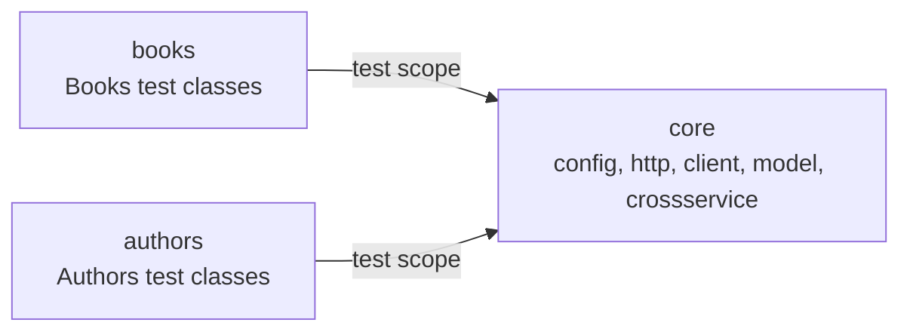

# Bookstore API test suite

A sample REST API test suite for the public [FakeRestAPI](https://fakerestapi.azurewebsites.net) bookstore demo. It exercises the Books resource end to end and the Authors resource including its per-book filter, in Java 17 with TestNG, RestAssured and Allure 3.

The suite's job is to report what the service does, not to make it look conventional. The demo is stateless and returns some responses that contradict REST expectations; every one of those is asserted as measured and listed under [Deviations](#deviations). Nothing is worked around, retried or normalised.

## Quick start

```bash
./mvnw -B clean verify allure:aggregate    # 87 cases, then one static report
./mvnw -B allure:serve                     # or serve the same 87 cases, from the repo root
```

Maven runs the three modules' tests first and then re-enters the root project to run the aggregator goal, which is why the log shows `allure:aggregate` under `[5/4]` after the last module. The report therefore reads the results the same invocation just produced. CI keeps the aggregate in its own step with `if: always()` instead, so a red run still publishes its report.

All three modules write their Allure results into `target/allure-results` at the repository root (`pom.xml`), so `allure:serve` started there reads all 87 and keeps serving until Ctrl-C. `allure:aggregate` plus `allure open` produces the same content as a static report. Run `allure:serve` from the root: from a module directory there are no results to read.

The report must be served either way. Opening `target/site/allure-maven-plugin/index.html` from disk renders an empty page, because the report fetches its data over HTTP. `allure:aggregate` downloads the Allure CLI into `.allure/` on its first run, which is the binary the second line uses; `npx allure open <dir>` works too.

`clean` matters locally: `target/allure-results` accumulates across runs, so a report built without it shows tests that no longer exist.

JDK 17 or newer is required (the compiler targets 17). The Maven wrapper pins the Maven version, so no local install is needed. The suite talks to the live host; the base URI, timeouts and logging level are described in [Configuration](#configuration).

## Layout



`core` holds the configuration, the HTTP layer, the two fluent clients, the generated models, the payload factories, the infrastructure tests and the cross-service test. `books` and `authors` hold test classes and their own data factories, nothing else. The dependency arrow points one way, so a service module cannot reach into another service module.

```text
core/src/main/java/io/github/tasostilsi/bookstore/
  client/      Api, BooksApi, AuthorsApi, ApiSpec
  config/      ApiConfig, ApiPaths
  data/        RandomData
  http/        ApiResponse, ApiResponseAssert
  model/       generated from the committed OpenAPI snapshot
core/src/test/java/io/github/tasostilsi/bookstore/
  http/         ApiResponseEdgeTest
  model/        ModelDeserialisationTest
  crossservice/ BooksAuthorsConsistencyTest
books/src/test/java/io/github/tasostilsi/bookstore/books/
  BooksReadTest, BooksCreateTest, BooksUpdateTest, BooksDeleteTest, BooksValidationTest
  protocol/    ProtocolTest, ErrorFormatTest
  data/        BooksData
authors/src/test/java/io/github/tasostilsi/bookstore/authors/
  AuthorsReadTest, AuthorsWriteTest, AuthorsByBookTest
  data/         AuthorsData
```

## What it covers

| Class | Cases | Groups |
|---|---|---|
| `BooksReadTest` | 15 | `contract`, `dynamicData` |
| `BooksCreateTest` | 15 | `contract`, `deviation`, `validationGap` |
| `BooksUpdateTest` | 8 | `contract`, `deviation` |
| `BooksDeleteTest` | 5 | `contract`, `deviation` |
| `BooksValidationTest` | 5 | `contract`, `deviation` |
| `ProtocolTest` | 4 | `contract` |
| `ErrorFormatTest` | 3 | `contract` |
| `AuthorsReadTest` | 8 | `contract`, `dynamicData` |
| `AuthorsWriteTest` | 7 | `contract`, `deviation`, `validationGap` |
| `AuthorsByBookTest` | 9 | `contract` |
| `BooksAuthorsConsistencyTest` | 2 | `crossservice`, `deviation` |

Seventy-nine cases in the eleven functional classes, plus eight in `core` that prove the infrastructure rather than the API: `ApiResponseEdgeTest` (empty body, absent content type, and that the assertion chain rejects a wrong value) and `ModelDeserialisationTest`. The `books` and `authors` clients are exercised through `@Step`-annotated methods, so every Allure result carries the operation it performed.

The groups are the selection mechanism:

| Group | Meaning |
|---|---|
| `contract` | Behaviour that matches a REST or RFC expectation. |
| `deviation` | Behaviour that contradicts one. |
| `validationGap` | Input accepted where it should be rejected, or the reverse. |
| `dynamicData` | The assertion reads a value the service regenerates per request. |
| `crossservice` | The assertion spans Books and Authors. |

A method can carry two groups, for example `{"deviation", "validationGap"}`. The full rules and the Allure label mapping are in `docs/design.md` and `docs/adr/ADR-0010-group-based-test-taxonomy.md`.

## Running a subset

```bash
./mvnw -B -Dgroups=deviation test     # one group, whole reactor
./mvnw -B -Dgroups=crossservice test
./mvnw -B -pl core -Dtest=ModelDeserialisationTest test    # one offline class
```

`-pl <module> -am` also builds and tests `core`, which includes the live cross-service class, so it is not an offline run. Selecting a module without `-am` fails: the reactor has to build `core` first for its snapshot to resolve.

## Deviations

Each row was measured on the live service before it was asserted. The test named in the last column is the executable record. These are reported, not fixed: the service is a public demo, and a suite that hid its behaviour would be worth less than one that pins it.

| Convention | What the service does | Test |
|---|---|---|
| `POST` to a collection returns `201` with a `Location` header. | Returns `200` echoing the payload, with no `Location`. | `BooksCreateTest.createEchoesPayloadWith200AndNoLocation`, `AuthorsWriteTest.createEchoesPayloadWith200AndNoLocation` |
| A created resource can be read back. | Nothing is stored; a `GET` of the new id returns `404`. | `createDoesNotPersist` in both write classes |
| A missing required field is rejected with `400`. | An empty body resets every field to a default: `id` 0, `pageCount` 0, `publishDate` `0001-01-01T00:00:00`. | `createWithEmptyObjectReturnsDefaults`, `createWithoutIdReturnsIdZero`, `createWithoutIdBookDefaultsToZero`, `updateWithEmptyObjectResetsFields` |
| Unknown fields are rejected, or accepted and stored. | Silently dropped. | `createSilentlyDropsUnknownFields` |
| A negative page count is rejected. | Accepted with `200`. | `createAcceptsNegativePageCount` |
| A foreign key points at an existing row. | `idBook` 99999 is accepted. | `createAcceptsForeignKeyOutsideBookRange` |
| `PUT` targets the resource named in the path. | The body's `id` wins over the path id. | `updateUsesBodyIdNotPathId` in both write classes |
| `PUT` on an absent resource returns `404`, or creates it. | Returns `200` echoing the body. | `updateSucceedsForAbsentId` |
| `PUT` replaces the resource; omitted fields are not silently cleared. | Omitted fields are set to null. | `updateNullsOmittedFields` |
| A successful `PUT` changes the resource it targets. | Changes nothing; a later `GET` returns the stored book. | `updateDoesNotPersist` |
| `DELETE` returns `204` when no representation is returned. | Returns `200` with zero bytes and no `Content-Type`. | `deleteExistingReturns200WithEmptyBody` |
| `DELETE` removes the resource. | Removes nothing; the resource is still there afterwards. | `deleteDoesNotRemoveResource`, `deleteReturns200AndRemovesNothing` |
| `DELETE` on an absent resource returns `404`. | Returns `200`. | `deleteSucceedsForAbsentId` |
| Path segments are case-sensitive (RFC 3986). | A mixed-case spelling resolves to the same resource. | `lowercasePathResolves` |
| `page` and `size` query parameters page the collection or are rejected. | Ignored; the full list is returned. | `queryParametersAreIgnored` |

One more recorded inconsistency, this time in the error envelope. A `404` for a missing book carries `application/problem+json; charset=utf-8; v=1.0`, while a `404` for a path that matches no endpoint carries no `Content-Type` and no body. The `400` and `415` problem responses carry the same envelope as the first but without the version parameter. `ErrorFormatTest` and `ProtocolTest.unknownRouteReturns404WithEmptyBody` pin both halves.

## Generated models

The service publishes OpenAPI 3.0.1 at `/swagger/v1/swagger.json`. A snapshot is committed at `core/src/main/resources/spec/openapi.json` and the models are generated from it at build time into `core/target/generated-sources/openapi`. A build therefore never needs the service to be reachable, and two builds cannot disagree about the contract.

```bash
scripts/refresh-openapi-spec.sh    # re-download the spec, validate it, regenerate
```

The script fetches with `curl -fsSL`, checks the document with `jq` before it replaces the tracked file, and prints the diff.

Valid request payloads are built from the same generated types, so a snapshot change that renames a field breaks the build instead of quietly sending the old shape. Empty, malformed, array, wrong-type and unknown-field bodies stay as JSON strings, because a typed constructor cannot express them. See [Random payloads](#random-payloads).

`publishDate` is the one response field that does not fit its generated type. A normal `GET /Books/{id}` returns a UTC-offset timestamp that binds as `OffsetDateTime`. A partial or empty `PUT` returns `0001-01-01T00:00:00`, which has no offset and cannot be parsed into that type. The update test asserts that value through JsonPath, and says in a `@Description` why.

## Random payloads

`BooksData.book()` and `AuthorsData.author()` return generated models filled from [datafaker](https://www.datafaker.net): title, description, excerpt, page count, first name and last name differ on every run, and every test asserts the echo against the instance it sent rather than against a literal. Ids come from ranges the service does not serve (books 201..8999, authors 7000..8999), so a create-then-`GET` pair cannot read stored data by accident.

The generator is seeded once per JVM from `-Ddata.seed`, or from a fresh random seed when the property is absent. The seed is printed at startup and attached to every test that generated a payload:

```text
[data] faker seed -62509015588610612 (rerun with -Ddata.seed=-62509015588610612)
```

Passing that value back reproduces the data, provided the test classes execute in the same order, because one generator serves the whole JVM. Each module runs in its own JVM and prints its own seed; `-Ddata.seed` sets all three.

Two details exist because of measured service behaviour. Dates are truncated to microseconds before they are sent, because the service keeps 7 fractional digits and a nanosecond value would come back changed. Unset fields are omitted rather than sent as `null`, because a `POST` with `"id":null` answers `400` while an omitted field binds to the default.

## The other three resources

The same spec declares `CoverPhotos` (`/api/v1/CoverPhotos`), `Activities` (`/api/v1/Activities`) and `Users` (`/api/v1/Users`). They are not covered here. Their models are already generated into `io.github.tasostilsi.bookstore.model`, so adding one is a test class plus a data fixture, a client method alongside `BooksApi` and `AuthorsApi`, a constant block in `ApiPaths`, and one line in `Api`. Nothing in the existing suite changes.

## Configuration

| Key | Default | Override |
|---|---|---|
| Base URI | `https://fakerestapi.azurewebsites.net` | `-Dapi.baseUri=...` or `API_BASE_URI` |
| Connect timeout | 5000 ms | `-Dapi.connectTimeoutMs=...` |
| Socket timeout | 10000 ms | `-Dapi.socketTimeoutMs=...` |
| Request/response logging | off | `-Dapi.logAll=true` |
| Data seed | a fresh random value per JVM, printed at startup | `-Ddata.seed=...` |

## Known limits

- The suite runs against the public host, so it needs network access. There are no retries: an origin outage or a `5xx` reads as a test failure. The CI job probes the host before the suite so a dead service is distinguishable from a contract failure.
- Authors data is regenerated per request. Totals vary between calls, so the suite asserts invariants (ids contiguous from 1, the set of `idBook` groups is exactly 1..200, authors per book match the path id) and never a total.
- RestAssured always sends a `Content-Type`, so a request with the header absent entirely cannot be expressed. The `text/plain` case stands in for the `415` contract.
- No containers, no mock server, no Jenkins. The demo is the system under test.

## Pipeline

`.github/workflows/api-tests.yml` runs on every push and pull request.

The `test` job checks the host answers `200`, runs `./mvnw -B clean verify` across the whole reactor once, aggregates the Allure report, and then guards the artifact: the aggregate goal warns about a module whose results are missing and still exits zero, so the job fails if fewer than 87 result files were produced. It also fails if no result carries the named step `GET /Books`, which is what proves the AspectJ weaver was attached; a count alone would stay green with the weaver broken. Surefire XML is attached as a JUnit report, and the results, the XML and the rendered report are uploaded as artifacts on every run, including a failed one.

The `deploy` job runs only for a push to `main`. It publishes the report artifact the `test` job already built, rather than re-running the suite: Pages then shows the same run whose results are attached to the workflow, and a second live run cannot fail after a green test job. Pages holds the newest report only.

## Further reading

`docs/design.md` describes the design and the reasoning; `docs/adr/` holds thirteen decision records, among them the measurement-before-assertion rule (`ADR-0009`), the group taxonomy (`ADR-0010`), the no-retries rule (`ADR-0011`) and the random-payload rule (`ADR-0013`).
