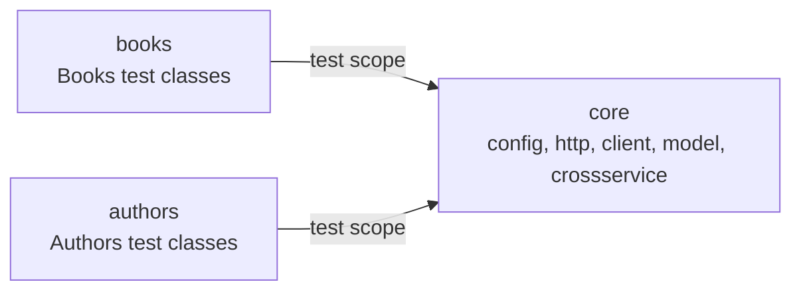

# Bookstore API test suite

A sample REST API test suite for the public [FakeRestAPI](https://fakerestapi.azurewebsites.net) bookstore demo. It exercises the Books resource end to end and the Authors resource including its per-book filter, in Java 17 with TestNG, RestAssured and Allure 3.

The suite asserts what a correct REST API is required to do, not what this demo happens to do. The demo is stateless: `POST` and `PUT` echo the payload instead of storing it, and `DELETE` removes nothing. Those are defects, so the tests that exercise them fail, and the failure list under [Defects](#defects) is the report. The suite is red by design.

## Quick start

```bash
./mvnw -B -Dmaven.test.failure.ignore=true clean verify allure:aggregate   # 91 cases, 25 defect failures
./mvnw -B allure:serve                                                      # or serve the same 91, from the repo root
```

`-Dmaven.test.failure.ignore=true` is not there to hide failures. Maven stops the reactor at the first failing module, so without it only `core` would run and the Books and Authors defects would never be recorded. The flag lets all three modules run; CI then fails the job on the failures it finds.

Maven runs the three modules' tests first and then re-enters the root project to run the aggregator goal, which is why the log shows `allure:aggregate` under `[5/4]` after the last module. The report therefore reads the results the same invocation just produced. CI keeps the aggregate in its own step with `if: always()` instead, so a red run still publishes its report.

All three modules write their Allure results into `target/allure-results` at the repository root (`pom.xml`), so `allure:serve` started there reads all 91 and keeps serving until Ctrl-C. `allure:aggregate` plus `allure open` produces the same content as a static report. Run `allure:serve` from the root: from a module directory there are no results to read.

The report must be served either way. Opening `target/site/allure-maven-plugin/index.html` from disk renders an empty page, because the report fetches its data over HTTP. `allure:aggregate` downloads the Allure CLI into `.allure/` on its first run, which is the binary the second line uses; `npx allure open <dir>` works too.

`clean` matters locally: `target/allure-results` accumulates across runs, so a report built without it shows tests that no longer exist.

JDK 17 or newer is required (the compiler targets 17). The Maven wrapper pins the Maven version, so no local install is needed. The suite talks to the live host; the base URI, timeouts and logging level are described in [Configuration](#configuration).

## Layout



`core` holds the configuration, the HTTP layer, the two fluent clients, the generated models, the payload factories, the infrastructure tests and the cross-service test. `books` and `authors` hold test classes and their own data factories, nothing else. The dependency arrow points one way, so a service module cannot reach into another service module.

```text
core/src/main/java/io/github/tasostilsi/bookstore/
  client/      Api, BooksApi, AuthorsApi, ApiSpec
  config/      ApiConfig, ApiPaths
  data/        RandomData
  http/        ApiResponse, ApiResponseAssert
  model/       generated from the committed OpenAPI snapshot
core/src/test/java/io/github/tasostilsi/bookstore/
  http/         ApiResponseEdgeTest
  model/        ModelDeserialisationTest
  crossservice/ BooksAuthorsConsistencyTest
books/src/test/java/io/github/tasostilsi/bookstore/books/
  BooksReadTest, BooksCreateTest, BooksUpdateTest, BooksDeleteTest, BooksValidationTest
  protocol/    ProtocolTest, ErrorFormatTest
  data/        BooksData
authors/src/test/java/io/github/tasostilsi/bookstore/authors/
  AuthorsReadTest, AuthorsWriteTest, AuthorsByBookTest
  data/         AuthorsData
```

## What it covers

| Class | Cases | Groups |
|---|---|---|
| `BooksReadTest` | 14 | `contract`, `regression`, `dynamicData` |
| `BooksCreateTest` | 15 | `contract`, `defect`, `regression` |
| `BooksUpdateTest` | 8 | `contract`, `defect` |
| `BooksDeleteTest` | 5 | `contract`, `defect` |
| `BooksValidationTest` | 5 | `contract`, `regression` |
| `ProtocolTest` | 4 | `contract` |
| `ErrorFormatTest` | 3 | `contract` |
| `AuthorsReadTest` | 8 | `contract`, `dynamicData` |
| `AuthorsWriteTest` | 9 | `contract`, `defect` |
| `AuthorsByBookTest` | 9 | `contract` |
| `BooksAuthorsConsistencyTest` | 2 | `crossservice`, `contract`, `defect` |

Eighty-two cases in the eleven functional classes, plus nine in `core` that prove the infrastructure rather than the API: `ApiResponseEdgeTest` (empty body, absent content type, `Location` parsing, and that the assertion chain rejects a wrong value) and `ModelDeserialisationTest`. The `books` and `authors` clients are exercised through `@Step`-annotated methods, so every Allure result carries the operation it performed.

The groups are the selection mechanism:

| Group | Meaning |
|---|---|
| `contract` | True of any correct REST API, whether or not this demo satisfies it. |
| `defect` | A modifier on a `contract` method that this service violates. Expected to fail until the service is fixed. |
| `regression` | Measured behaviour of this implementation that no contract requires: seed ranges, case-insensitive routing, ignored query parameters, values the schema does not constrain. |
| `dynamicData` | The assertion reads a value the service regenerates per request. |
| `crossservice` | The assertion spans Books and Authors. |

A defect method carries both `contract` and `defect`, so the contract count includes the 25 defects. The full rules and the Allure label mapping are in `docs/design.md` and `docs/adr/ADR-0014-contract-first-assertions-and-a-red-gate.md`.

## Running a subset

```bash
./mvnw -B -Dgroups=contract test     # one group, whole reactor
./mvnw -B -Dgroups=regression test
./mvnw -B -Dgroups=defect -Dmaven.test.failure.ignore=true test   # only the 25 defects
./mvnw -B -pl core -Dtest=ModelDeserialisationTest test    # one offline class
```

`-pl <module> -am` also builds and tests `core`, which includes the live cross-service class, so it is not an offline run. Selecting a module without `-am` fails: the reactor has to build `core` first for its snapshot to resolve.

## Defects

Each row is a requirement the service does not meet. The test named in the last column asserts the requirement, fails against this service, and will pass when it is fixed. Measured values are from the live demo on 2026-10-28.

| Requirement | Expected | Measured | Test |
|---|---|---|---|
| `POST` to a collection creates a resource (RFC 9110 9.3.3, 15.3.2). | `201` with a `Location`. | `200` echoing the payload, no `Location`. | `createReturns201WithLocation` in both write classes |
| The created resource is readable (RFC 9110 9.3.3). | `GET` of the `Location` returns `200` with the sent representation. | Nothing is stored; `404`. | `createMakesResourceReadableAtLocation` in both write classes |
| The server owns identity. | An omitted `id`/`idBook` is assigned by the server and returned in `Location`. | `id` and `idBook` default to `0`, echoed with `200`. | `createWithoutIdAssignsServerId`, `createWithoutIdBookCreatesReadableResource` |
| The schema declares no required fields, so `{}` is valid. | `201`, then a readable resource with a server id. | `200` with `id` 0, `pageCount` 0 and `publishDate` `0001-01-01T00:00:00`. | `createWithEmptyObjectCreatesReadableResource` |
| The schema declares `additionalProperties: false`. | An unknown field is rejected with `400`. | Accepted, field silently dropped. | `createWithUnknownFieldReturns400` |
| A valid unicode title survives creation. | `201`, then the same title on `GET`. | `200` echoing the payload. | `createWithUnicodeTitleRoundTrips` |
| `idBook` references an existing book. | `400`, `409` or `422` for an unknown id. | `200`; `99999` accepted. | `createWithNonExistentBookIdIsRejected` |
| `PUT` to an existing resource replaces it (RFC 9110 9.3.4). | `200` or `204`, and the replacement is what a later `GET` returns. | `200` echoing the payload; a later `GET` returns the stored book. | `updateExistingBookReturns200Or204`, `updateIsVisibleOnNextRead`, `updateExistingAuthorReplacesRepresentation` |
| `PUT` to an absent id creates it (RFC 9110 9.3.4). | `201` with a `Location`, then a readable resource. | `200` echoing the body, with `id` 0 when the body omits it. | `updateAbsentIdCreates201WithLocation`, `updateAbsentAuthorCreates201WithLocation` |
| The resource is identified by its URI. | Replacing with `{}` keeps the path id. | Echoes `id` 0 and resets every field. | `updateWithEmptyObjectKeepsPathId` |
| `PUT` replaces; omitted fields are cleared (RFC 9110 9.3.4). | A later `GET` returns `null` for the omitted fields. | `200` echo only; a later `GET` returns the stored book. | `updateReplacesOmittedFieldsWithNull` |
| A body id that disagrees with the path is an inconsistent representation (RFC 9110 9.3.4). | `409`. | `200`; the body id wins. | `updateWithMismatchedBodyIdReturns409` in both write classes |
| A successful `DELETE` returns `204` with no body (RFC 9110 9.3.5). | `204`, empty body, no `Content-Type`. | `200`, zero bytes, no `Content-Type`; nothing is removed. | `deleteExistingReturns204WithNoBody`, `deleteExistingAuthorReturns204AndRemoves` |
| `DELETE` removes the resource (RFC 9110 9.3.5). | A later `GET` is `404`, and a second `DELETE` is `404`. | The resource is still there. | `deleteRemovesResourceAndLaterGetReturns404`, `deleteExistingAuthorReturns204AndRemoves` |
| `DELETE` on an absent resource is `404` (RFC 9110 15.5.5). | `404`. | `200`. | `deleteAbsentIdReturns404`, `deleteAbsentAuthorReturns404` |
| A created book and the author that references it are both visible. | Both reads succeed, and the by-book filter returns the author. | Neither is stored; both `GET`s return `404`. | `createdResourcesAreVisibleAcrossBothResources` |

Twenty-five tests fail. The 66 that pass include the validation, protocol and error-envelope contract tests, which this service does satisfy.

## Measured behaviour

These assertions record this implementation's choices where no contract decides the answer. They are labelled `regression` and they pass.

| Behaviour | Test |
|---|---|
| The collection is exactly the 200 seeded books, ids contiguous from 1. | `BooksReadTest` list tests, `getBookAtUpperBoundReturnsIt` |
| Path matching is case-insensitive, and a trailing slash resolves to the collection. | `BooksValidationTest.mixedCasePathResolves`, `trailingSlashResolves` |
| `page` and `size` query parameters are ignored; the collection endpoint declares none. | `BooksValidationTest.queryParametersAreIgnored` |
| A negative page count and a 10,000-character title are accepted; the schema sets no minimum or `maxLength`. | `BooksCreateTest.createAcceptsNegativePageCount`, `createAcceptsVeryLongTitle` |
| A path id above `int32` is a `400` (the binder), not a `404`. | `BooksReadTest.int32OverflowIdReturns400` |
| `publishDate` carries a UTC offset and equals `Date` minus the book id in days. | `BooksReadTest.publishDateIsParsableOffsetDateTime`, `publishDateIsNowMinusNDays` |

## Generated models

The service publishes OpenAPI 3.0.1 at `/swagger/v1/swagger.json`. A snapshot is committed at `core/src/main/resources/spec/openapi.json` and the models are generated from it at build time into `core/target/generated-sources/openapi`. A build therefore never needs the service to be reachable, and two builds cannot disagree about the contract.

```bash
scripts/refresh-openapi-spec.sh    # re-download the spec, validate it, regenerate
```

The script fetches with `curl -fsSL`, checks the document with `jq` before it replaces the tracked file, and prints the diff.

Valid request payloads are built from the same generated types, so a snapshot change that renames a field breaks the build instead of quietly sending the old shape. Empty, malformed, array, wrong-type and unknown-field bodies stay as JSON strings, because a typed constructor cannot express them. See [Random payloads](#random-payloads).

## Random payloads

`BooksData.book()` and `AuthorsData.author()` return generated models filled from [datafaker](https://www.datafaker.net): title, description, excerpt, page count, first name and last name differ on every run, and every assertion compares the sent instance with the served representation rather than with a literal. The ids the tests send are chosen above the seeded range (books 201..8999, authors 7000..8999), so a write never addresses stored data; the id a correct service assigns is read from the `Location` header.

The generator is seeded once per JVM from `-Ddata.seed`, or from a fresh random seed when the property is absent. The seed is printed at startup and attached to every test that generated a payload:

```text
[data] faker seed -62509015588610612 (rerun with -Ddata.seed=-62509015588610612)
```

Passing that value back reproduces the data, provided the test classes execute in the same order, because one generator serves the whole JVM. Each module runs in its own JVM and prints its own seed; `-Ddata.seed` sets all three.

Two details exist because of measured service behaviour. Dates are truncated to microseconds before they are sent, because the service keeps 7 fractional digits and a nanosecond value would come back changed. Unset fields are omitted rather than sent as `null`, because a `POST` with `"id":null` answers `400` while an omitted field binds to the default.

## The other three resources

The same spec declares `CoverPhotos` (`/api/v1/CoverPhotos`), `Activities` (`/api/v1/Activities`) and `Users` (`/api/v1/Users`). They are not covered here. Their models are already generated into `io.github.tasostilsi.bookstore.model`, so adding one is a test class plus a data fixture, a client method alongside `BooksApi` and `AuthorsApi`, a constant block in `ApiPaths`, and one line in `Api`. Nothing in the existing suite changes.

## Configuration

| Key | Default | Override |
|---|---|---|
| Base URI | `https://fakerestapi.azurewebsites.net` | `-Dapi.baseUri=...` or `API_BASE_URI` |
| Connect timeout | 5000 ms | `-Dapi.connectTimeoutMs=...` |
| Socket timeout | 10000 ms | `-Dapi.socketTimeoutMs=...` |
| Request/response logging | off | `-Dapi.logAll=true` |
| Data seed | a fresh random value per JVM, printed at startup | `-Ddata.seed=...` |

## Known limits

- The suite runs against the public host, so it needs network access. There are no retries: an origin outage or a `5xx` reads as a test failure. The CI job probes the host before the suite so a dead service is distinguishable from a contract failure.
- The suite is red by design: 25 tests assert requirements this demo does not meet. The local Maven exit is `0` because failures are ignored so the reactor reaches every module; CI turns the run red in a step that reads the Allure results.
- Authors data is regenerated per request. Totals vary between calls, so the suite asserts invariants (ids contiguous from 1, the set of `idBook` groups is exactly 1..200, authors per book match the path id) and never a total.
- RestAssured always sends a `Content-Type`, so a request with the header absent entirely cannot be expressed. The `text/plain` case stands in for the `415` contract.
- No containers, no mock server, no Jenkins. The demo is the system under test.

## Pipeline

`.github/workflows/api-tests.yml` runs on every push and pull request.

The `test` job checks the host answers `200`, runs `./mvnw -B -Dmaven.test.failure.ignore=true clean verify` across the whole reactor, aggregates the Allure report, and then guards the artifact: the aggregate goal warns about a module whose results are missing and still exits zero, so the job fails if fewer than 91 result files were produced. It also fails if no result carries the named step `GET /Books`, which is what proves the AspectJ weaver was attached; a count alone would stay green with the weaver broken. A final step lists every failed result and exits nonzero, which is what makes the run red once the 25 defects are recorded. Surefire XML is attached as a JUnit report, and the results, the XML and the rendered report are uploaded as artifacts on every run, including a failed one.

The `deploy` job runs for a push to `main` whether or not the test job passed, because the failing report is the point. It publishes the report artifact the `test` job already built, rather than re-running the suite: Pages then shows the same run whose results are attached to the workflow. Pages holds the newest report only.

## Further reading

`docs/design.md` describes the design and the reasoning; `docs/adr/` holds fifteen decision records, among them the contract-first rule (`ADR-0014`), the lifecycle isolation rule (`ADR-0015`), the group taxonomy (`ADR-0010`), the no-retries rule (`ADR-0011`) and the random-payload rule (`ADR-0013`).
