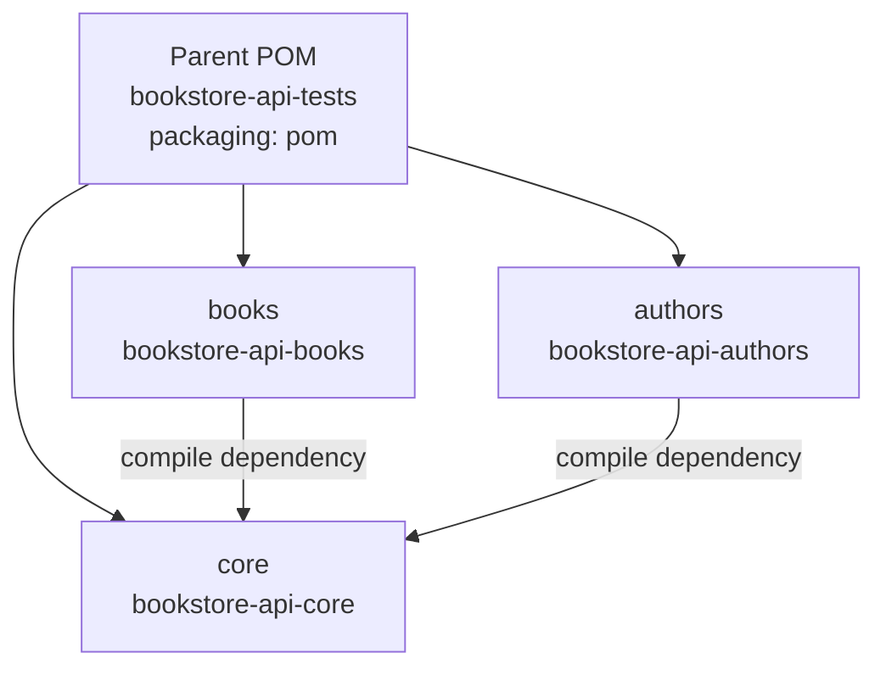
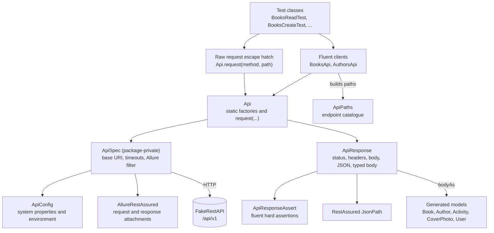

# Design overview

This document explains the structure of the `bookstore-api-tests` repository: what it tests, how the modules and classes fit together, how a test is written, and how the build is configured. It describes the code in this repository. It does not restate every test case; the design decisions live in `docs/adr/`.

The service under test is the public FakeRestAPI bookstore at `https://fakerestapi.azurewebsites.net`, with the path prefix `/api/v1` (`core/src/main/java/io/github/tasostilsi/bookstore/config/ApiPaths.java`).

## 1. What the suite tests and why

The suite exercises the Books and Authors resources of a public demo API. Neither resource requires authentication. The API is stateless: a successful write returns an echo of the request and persists nothing. Several responses also contradict RFC 9110. For example, `POST /Books` returns `200` rather than `201`, `DELETE /Books/1` returns `200` with an empty body and removes nothing, and `PUT /Books/1` takes the resource id from the body rather than the path.

The tests assert the contract: what RFC 9110 and the committed OpenAPI snapshot require, whether or not this service satisfies it. A test that exercises a violated requirement fails, and that failure is the defect entry. Measurement is evidence for what the service does, not the source of the expected value. The rule is recorded in ADR-0014.

The suite covers:

- Books read, create, update and delete, including validation and path binding (`books/src/test/java/io/github/tasostilsi/bookstore/books/`).
- The HTTP layer itself: empty response bodies and absent `Content-Type` headers (`core/src/test/java/io/github/tasostilsi/bookstore/http/ApiResponseEdgeTest.java`).
- The generated models, using a measured wire payload (`core/src/test/java/io/github/tasostilsi/bookstore/model/ModelDeserialisationTest.java`).

- Authors read, write and by-book, including the collection's regenerated-data invariants (`authors/src/test/java/io/github/tasostilsi/bookstore/authors/`).

The remaining planned work is the public repository and its Pages settings. Every test class, the CI workflow and the README exist. See section 9 for the current state.

### Current inventory

| Area | Committed today | Plan target |
|---|---|---|
| `core` tests | 11 cases in 3 classes (`ApiResponseEdgeTest`, `ModelDeserialisationTest`, `BooksAuthorsConsistencyTest`) | Complete |
| `books` tests | 54 cases across 7 classes | Complete |
| `authors` tests | 26 cases in 3 classes (`AuthorsReadTest`, `AuthorsWriteTest`, `AuthorsByBookTest`) | Complete |
| Reactor total | 81 methods, 91 cases; 25 fail against the demo | 81 methods, 91 cases |

The original plan targeted 76 methods and 87 cases. The contract-first revision added three `ApiResponseEdgeTest` cases and two `AuthorsWriteTest` cases, and removed one absent-id row that a corrected service could satisfy by assigning that id. Two methods were cut at review, both because they asserted less than their names claimed. `ErrorFormatTest` lost a fourth case that re-issued `BooksDeleteTest.deleteExistingReturns204WithNoBody` and asserted the same two absences. `BooksAuthorsConsistencyTest` lost a by-book case that called the Authors client only, which contradicts the definition of the `crossservice` group; its one extra provider row moved to `AuthorsByBookTest`.

The class-level policy that replaces ad-hoc duplication calls: `ErrorFormatTest` is the canonical home of the error envelope and re-issues requests other classes already make, because it asserts envelope content (the version parameter, the exact `type` URI, the exact `title`) that the shared helpers leave to callers. Every other class asserts behaviour. A case is only cut when it asserts nothing the suite does not already assert.

## 2. The four-module reactor

The repository is a Maven reactor with a parent POM and three modules:



The parent declares the modules and owns every version (`pom.xml`). Module POMs declare dependencies without versions (`core/pom.xml`, `books/pom.xml`, `authors/pom.xml`).

What belongs in each module:

| Module | Contents |
|---|---|
| `core` | Shared code: configuration, HTTP wrapper, fluent clients, generated models, the seeded generator, and the infrastructure test classes, including the cross-service test that needs both clients. |
| `books` | Books test classes and their data factories, including the protocol and error-format classes. |
| `authors` | Authors test classes and their data factories. |

The dependency arrow points one way. `books` and `authors` depend on `core`; `core` has no dependency on either service module. That is what keeps the reactor acyclic and lets a cross-service test live in `core`, where both clients are already visible. The rule is visible in `core/pom.xml`, which declares no internal dependency.

Why modules at all: adding a service means adding a module, a client class, a block in `ApiPaths` and a test package. It does not mean editing a shared class list. The cost is three extra POMs. For a single-service suite that cost would not be worth paying. Here the module boundary is part of the structure a reader is meant to see.

The ADR on the four-module reactor records the alternatives: a single module, and a fifth module for cross-service tests.

## 3. Client and assertion layering

Every request goes through `io.github.tasostilsi.bookstore.client.Api`. No test calls RestAssured `given()` directly. This is checked by reading the test sources: `books/src/test`, `authors/src/test` and `core/src/test` contain no `given()` call.



The request path:

1. A test calls a terminal on a fluent client, for example `Api.books().get(1)` (`core/src/main/java/io/github/tasostilsi/bookstore/client/BooksApi.java`).
2. The terminal calls `Api.request(...)` (`core/src/main/java/io/github/tasostilsi/bookstore/client/Api.java`).
3. `Api.request` obtains a `RequestSpecification` from `ApiSpec.request()`, adds headers, content type and body when supplied, executes the request, and wraps the RestAssured `Response` in `ApiResponse`.
4. `ApiSpec` sets the base URI, connect and read timeouts, redirect following off, the `AllureRestAssured` filter, and optional request/response logging. It sets no default `Content-Type`; the body-bearing client calls set that header explicitly (`core/src/main/java/io/github/tasostilsi/bookstore/client/ApiSpec.java`).

The response path:

1. `ApiResponse` exposes `status()`, `header(name)`, `contentType()`, `body()`, `hasBody()`, `locationId()`, `json()`, `bodyAs(Class)`, `bodyAsList(Class)` and `assertThat()` (`core/src/main/java/io/github/tasostilsi/bookstore/http/ApiResponse.java`). `locationId()` reads the last path segment of `Location` and throws when the header is absent; it is how a fixture learns the id the server assigned, rather than assuming the id it sent was stored (ADR-0015).
2. `contentType()` reads the raw `Content-Type` header rather than `getContentType()`, because the latter normalises an absent header to an empty string. The contract distinguishes absent from empty.
3. `json()`, `bodyAs()` and `bodyAsList()` call `requireBody()` first. If the body is empty they throw `IllegalStateException` naming the status and status line, rather than letting a parser fail with an opaque message.
4. `assertThat()` returns an `ApiResponseAssert`, a fluent chain of hard assertions (`core/src/main/java/io/github/tasostilsi/bookstore/http/ApiResponseAssert.java`).
5. The generated models are the response-side type target. `bodyAs` and `bodyAsList` deserialise into them.

`ApiPaths` is the single endpoint catalogue (`core/src/main/java/io/github/tasostilsi/bookstore/config/ApiPaths.java`). It holds `BASE_PATH`, `BOOKS`, `AUTHORS`, `AUTHORS_BY_BOOK`, and the overloads `book(int)`, `book(String)`, `author(int)`, `author(String)`, `authorsByBook(int)` and `authorsByBook(String)`. The string overloads concatenate the segment verbatim, so a test can express a non-integer path segment such as `abc` or `1.5`.

`ApiConfig` is the configuration boundary (`core/src/main/java/io/github/tasostilsi/bookstore/config/ApiConfig.java`). `baseUri()` reads the `api.baseUri` system property, then the `API_BASE_URI` environment variable, then the default. The timeout and logging settings read only system properties.

The `Api.request` overloads are the escape hatch for requests that do not fit a resource terminal: unsupported methods, path-binding probes and custom headers. `request(String, String)` sends a bare request, `request(String, String, Map)` adds headers, `request(String, String, Object, Map)` serialises a generated model with nulls omitted, and `request(String, String, String, String, Map)` adds a raw body and its `Content-Type`. A raw request carries no client `@Step`, so its Allure entry contains only the `HTTP exchange` step from `AllureRestAssured`. That is why the protocol tests use `Api.request` and accept the shorter report entry.

The ADRs on the fluent client and on the response wrapper record why there is no generic request builder and no raw RestAssured assertions in tests.

## 4. How a test is written

Test classes carry class-level Allure labels and a TestNG group on each method. This is the pattern from `books/src/test/java/io/github/tasostilsi/bookstore/books/BooksReadTest.java`:

```java
@Epic("Bookstore API")
@Feature("Books read")
@Severity(SeverityLevel.CRITICAL)
@Link(name = "OpenAPI specification", url = "https://fakerestapi.azurewebsites.net/swagger/v1/swagger.json")
public class BooksReadTest {
```

A representative method from the same file:

```java
@Test(groups = "contract")
public void getExistingBookReturnsIt() {
    ApiResponse r = Api.books().get(1);
    r.assertThat().hasStatus(200)
            .hasField("id", 1).hasField("title", BOOK_1_TITLE)
            .hasField("pageCount", BOOK_1_PAGE_COUNT).hasNonNullField("description");
    assertThat(r.json().getMap("$").keySet(), containsInAnyOrder(
            "id", "title", "description", "pageCount", "excerpt", "publishDate"));
}
```

What each part does:

- `@Test(groups = "contract")` makes the method selectable with `-Dgroups=contract`. Groups are declared on every method, not inherited from the class, so a renamed class cannot silently fall out of a group-based run.
- `Api.books().get(1)` is the only HTTP call. The test does not build a request specification and does not know the base URI or path prefix.
- `assertThat()` starts the assertion chain. Each call returns the same assertion object, so the chain reads as one statement.
- `hasField` compares the JsonPath value with the expected one. `hasNonNullField` checks presence and non-null in one call; `hasInstantField` compares a timestamp by instant, because the service keeps seven fractional digits.
- The final Hamcrest assertion checks the exact top-level key set. It is written directly because the chain does not express set equality. Hamcrest arrives transitively with RestAssured; no AssertJ dependency is declared.
- `BOOK_1_TITLE` and `BOOK_1_PAGE_COUNT` come from `books/src/test/java/io/github/tasostilsi/bookstore/books/data/BooksData.java`, which also holds the factories that generate request payloads. Measured values are constants, generated payloads are factory calls, and neither needs a shared base class.

A defect method carries both `contract` and `defect`, and adds the defect feature label. `BooksCreateTest.createReturns201WithLocation` is the smallest example:

```java
@Test(groups = {"contract", "defect"})
@Feature("Contract defects")
@Description("RFC 9110 9.3.3 and 15.3.2: creating a resource answers 201 with a Location")
public void createReturns201WithLocation() {
    Api.books().create(BooksData.book()).assertThat().hasStatus(201).hasHeader("Location");
}
```

`contract` is the requirement the method asserts. `defect` says this service is known to violate it, so the method is expected to fail until the service changes; the failure, not a recorded measurement, is the defect entry. `@Feature` is repeatable, so the method appears under both the class feature and `Contract defects` in the Behaviors view. A measured behaviour that no contract requires carries `@Feature("Measured behaviour")` and the `regression` group instead. A method whose failure is obvious without explanation carries no `@Description`; one whose measured gap is not obvious in the assertion does.

A test that needs a created resource asserts the create's `201` with a reason, for example `hasStatus(201, "precondition: a correct service stores the book it creates and returns its Location")`. The reason makes the report say which assertion failed first instead of leaving the method name to promise the subject. The reason is used only on a fixture, never on an assertion that is the test's subject.

Valid request bodies are built from the generated types. The service also accepts empty, malformed, partial, array and wrong-type bodies, and those stay JSON strings, because a typed constructor would default a field and silently change the payload under test. So both terminals exist: `create(Book)` and `update(int, Book)` for generated data, `create(String)` and `update(int, String)` for the payloads a model cannot express.

Data providers expand a method into several cases. `BooksReadTest` has a provider for the three absent ids and one for the publish-date samples. The case count is therefore higher than the method count.

## 5. Requests, assertions and Allure steps

Three mechanisms connect a test to the report.

**`@Step` on client terminals.** Each resource operation carries an Allure `@Step` naming the verb and path, for example `@Step("GET /Books/{id}")` and `@Step("POST /Books")`. The one-argument `create(String)` delegates to the annotated `create(String, String)` overload. The method parameters fill the `{id}` placeholder, which requires `<parameters>true</parameters>` on `maven-compiler-plugin` (`pom.xml`). A test such as `deleteRemovesResourceAndLaterGetReturns404` therefore records its POST and its three subsequent operations without any `Allure.step` wrapper in the test.

**AspectJ weaving.** `@Step` writes nothing unless the AspectJ weaver is attached to the test JVM. The parent POM declares `aspectjweaver` as a Surefire plugin dependency and passes it as `-javaagent` on `argLine` (`pom.xml`). The path is quoted because Surefire tokenises `argLine` before forking. A missing agent produces no steps and no error, which is why the CI workflow checks for a named step rather than only a non-empty steps array.

**`AllureRestAssured`.** `ApiSpec` registers the filter on every request. It adds an `HTTP exchange` step containing the request and response attachments. This is why tests that go through `Api.request` still have a report entry even though `Api.request` itself has no `@Step`.

The result files go to one `target/allure-results` at the repository root, because Surefire sets the `allure.results.directory` system property to `${maven.multiModuleProjectDirectory}/target/allure-results` (`pom.xml`). One directory is what lets `allure:serve` read the whole suite; see ADR-0004. The `allure-testng` listener is registered by the library's service file, so no `testng.xml` and no listener wiring appear in the project. `./mvnw -B allure:aggregate` combines the results into `target/site/allure-maven-plugin`.

Assertions do not create Allure steps. They are hard assertions executed inside the test method. A failure throws from the assertion chain, and the stack includes the test line that called it, so the failing test is identifiable.

## 6. Spec snapshot and generated models

The service publishes an OpenAPI 3.0.1 document at `/swagger/v1/swagger.json`. A snapshot is committed at `core/src/main/resources/spec/openapi.json`. It contains 12 paths, 27 operations and five schemas (`Activity`, `Author`, `Book`, `CoverPhoto`, `User`).

Models are generated from the committed snapshot, never from the URL. A build therefore does not need the demo service to be reachable, and two builds on different days cannot disagree about the contract.

The generator is configured in `core/pom.xml`:

| Setting | Value | Effect |
|---|---|---|
| `openapi-generator-maven-plugin` | 7.26.0 | Version from the parent property. |
| goal | `generate` at `generate-sources` | Runs before compilation. |
| `inputSpec` | `${project.basedir}/src/main/resources/spec/openapi.json` | The committed snapshot. |
| `generatorName`, `library` | `java`, `native` | Java models with the native HTTP library support code. |
| `modelPackage` | `io.github.tasostilsi.bookstore.model` | Where the five model classes land. |
| `invokerPackage` | `io.github.tasostilsi.bookstore.generated` | Keeps `ApiClient`, `JSON` and the generated `ApiResponse` out of the project root package, away from the hand-written `http.ApiResponse` and `client.Api`. |
| `generateApis` | `false` | No API stubs. |
| `generateSupportingFiles` | `true` | Required: generated models call `ApiClient.urlEncode`, so the support classes must exist. |
| `generateModelTests`, `generateModelDocumentation` | `false` | Models only. |
| `openApiNullable` | `false` | Plain types, not `JsonNullable` wrappers. |
| `dateLibrary` | `java8` | `publishDate` becomes `OffsetDateTime`. |
| `serializationLibrary` | `jackson` | Jackson annotations and `JSON` mapper. |
| `useJakartaEe` | `true` | `jakarta.annotation` imports. |
| `hideGenerationTimestamp` | `true` | Reproducible generated sources. |

The output is `core/target/generated-sources/openapi`. The generated code is build output, not committed. The generated `core/target/generated-sources/openapi/src/main/java/io/github/tasostilsi/bookstore/model/Book.java` declares `publishDate` as `OffsetDateTime`.

To refresh the snapshot:

```bash
scripts/refresh-openapi-spec.sh
```

The script downloads the live document with `curl -fsSL`, validates with `jq -e` that it declares `openapi`, the five paths the suite calls and the `Book` and `Author` schemas, replaces `core/src/main/resources/spec/openapi.json`, sets the file mode, runs `./mvnw -B -pl core generate-sources`, and prints `git diff --stat` for the snapshot (`scripts/refresh-openapi-spec.sh`). The `-f` flag matters: without it an HTML error page would overwrite the tracked file. The `jq` guard rejects a truncated body or a maintenance page before the tracked file is replaced, and checking the covered paths rather than the document's size lets a new upstream endpoint through.

The models are the type target in both directions. `ApiResponse.bodyAs` and `bodyAsList` deserialise into them, and the request factories build them and serialise them through a copy of the generated mapper with nulls omitted. A field the spec does not declare makes the generated Jackson mapper ignore it unless a test enables strict handling. `ModelDeserialisationTest` copies the generated mapper and enables `FAIL_ON_UNKNOWN_PROPERTIES`, then deserialises a measured `GET /Books` payload and asserts that `publishDate` binds as `OffsetDateTime` (`core/src/test/java/io/github/tasostilsi/bookstore/model/ModelDeserialisationTest.java`).

Generated payloads come from one faker per JVM, seeded from `-Ddata.seed` or a fresh random value, with the seed printed at startup and attached to each test that generated data (`core/src/main/java/io/github/tasostilsi/bookstore/data/RandomData.java`). The request mapper omits nulls because a measured `POST` with `"id":null` answers `400`, while an omitted field binds to the default (`core/src/main/java/io/github/tasostilsi/bookstore/client/ApiSpec.java`).

The zero date does not fit the generated type. A `PUT /Books/1` with `{}` answers `200` with `"publishDate":"0001-01-01T00:00:00"`, which carries no offset and cannot parse as `OffsetDateTime`. No test reads that echo as a model. A test that needs the update's own answer asserts the contract instead, meaning a replacement or a `409` for a representation whose id disagrees with the path, and that assertion fails on this service with the requirement named rather than a parse error.

The ADR on generated models records why the snapshot is committed and what was rejected.

## 7. Test taxonomy

Every method carries at least one selection group. Three groups classify the requirement a method asserts. Two further groups mark orthogonal properties and can be combined with any of them.

| Group | Meaning | Allure label |
|---|---|---|
| `contract` | The assertion states what any correct REST API must do, whether or not this service does it. | Class `@Feature` (no override). |
| `defect` | A modifier on a `contract` method whose requirement this service violates. Expected to fail until the service is fixed. | `@Feature("Contract defects")` |
| `regression` | Measured behaviour of this implementation that no contract requires. Expected to pass; a change in it is a change in the service, not a broken test. | `@Feature("Measured behaviour")` |
| `dynamicData` | The assertion reads a value the service regenerates per request. Orthogonal to the classifying groups. | `@Feature("Dynamic data")` |
| `crossservice` | The assertion spans Books and Authors. Orthogonal to the classifying groups. | Class `@Feature` (no override). |

The rule that decides the classification:

1. State the requirement the method asserts, taken from the HTTP method semantics in RFC 9110, the problem-details shape, or the types the committed OpenAPI schema declares.
2. If the service meets the requirement, the method is `contract`.
3. If the service violates it, the method is `contract` and `defect`: the requirement is still part of the contract, and the `defect` modifier records that this service misses it.
4. If no contract decides the answer and the assertion records what this implementation does, the method is `regression`. Seed ranges, case-insensitive path matching and ignored query parameters belong here: neither answer is wrong.
5. Independently of the above, add `dynamicData` when the assertion reads a value the service regenerates per request, and `crossservice` when the test calls both Books and Authors.

Examples from the committed code:

- `createReturns201WithLocation` is `{"contract", "defect"}`: RFC 9110 9.3.3 and 15.3.2 require `201` with a `Location`, and the service answers `200`.
- `deleteRemovesResourceAndLaterGetReturns404` is `{"contract", "defect"}`: RFC 9110 9.3.5 requires removal, and the service removes nothing.
- `createWithMalformedJsonReturns400` is `contract` alone: a malformed body must be rejected, and this service rejects it.
- `createAcceptsNegativePageCount` is `regression`: the schema declares no minimum, so neither `400` nor `200` is required; the method records that `200` is what happens.
- `publishDateIsNowMinusNDays` is `dynamicData`, and `createdResourcesAreVisibleAcrossBothResources` is `{"crossservice", "contract", "defect"}`.

`defect` sits on top of `contract` rather than replacing it, so `-Dgroups=contract` selects the whole contract, failures included, and `-Dgroups=defect` selects the defect report alone. Both filters run the same assertions; they differ only in what they are asked to show.

Class-level labels are separate from the selection groups. Every class carries `@Epic("Bookstore API")`, a class-level `@Feature` naming the area and a class-level `@Severity`. A method-level `@Feature` override is added only for a label the class-level feature does not already name, so the cross-service class needs none for `crossservice` and one for `defect`. `@Link` points at the Swagger document on the service-area classes (`BooksReadTest`, `BooksCreateTest`, `BooksUpdateTest`, `BooksDeleteTest`, `BooksValidationTest`). The `core` infrastructure classes carry no link, because they assert the client and the generated types rather than a documented endpoint.

Severity is per class, not per method. `CRITICAL` is used on the primary CRUD classes, `NORMAL` on the validation, protocol, error-format and cross-service classes, and `MINOR` on the generated-model and response-wrapper infrastructure classes. A defect method inside a CRUD class therefore reports at that class's severity, not at a severity of its own.

There is no `@Story` label and no `testng.xml`. The method-level `@Feature` override already separates defects from measured behaviour in the Behaviors view, and a second hierarchy would duplicate it. Selection by class, package or group is enough; a suite XML would let a renamed class drop out of a run silently.

At the time of writing, the group filters select these case counts across the reactor, read from the Surefire reports of the run recorded in section 9 rather than counted by hand:

| Group | Cases |
|---|---|
| `contract` | 66 |
| `defect` | 25 |
| `regression` | 10 |
| `dynamicData` | 5 |
| `crossservice` | 2 |

The rows add to 108 against 91 cases, because 25 defect methods are also `contract` and one cross-service method also carries `defect`; nine `core` cases carry no group at all, being the generated-model test and the eight response-wrapper tests. The ADR on the test taxonomy records the alternatives and the label mapping.

## 8. Evidence discipline

Every expected value in the suite comes from the contract: RFC 9110, the problem-details shape, or the committed OpenAPI schema. A measurement of the live service is evidence for the defect report, never the source of an expected value. The schema declares only `200` responses, even for `POST` and `DELETE`, and no schema declares `required` fields, so it cannot decide status codes, required fields or error shapes; RFC 9110 can, and the schema decides the field types and the absence of `required`.

The rules that follow from that:

- An assertion encodes a requirement. When a test fails, the assertion is not the thing to change: the failure is either a defect in the service or a misreading of the contract, and the response body, the RFC and the schema settle which.
- The service is never worked around. There is no fallback payload, no response normalisation, no retry, and no relaxed assertion. A requirement the service misses stays failing and is listed in the Defects section of the `README.md`.
- There are no retries. The Surefire POM contains no `rerunFailingTestsCount` or retry plugin (`pom.xml`), and no group is excluded from the CI run.
- Empty bodies are handled, not parsed. `ApiResponse` guards `json()`, `bodyAs()` and `bodyAsList()` with `requireBody()` and throws `IllegalStateException` naming the status. `ApiResponseEdgeTest` pins this against a locally built empty `200`, so the test states the wrapper's rule without depending on which endpoint returns one; `BooksDeleteTest` pins the live `DELETE` shape as a defect.
- Absent `Content-Type` is asserted from the header map only. `ApiResponseAssert.hasNoContentType()` reads `contentType()` and never parses the body. `ApiResponseEdgeTest.absentContentTypeDoesNotParseBody` pins this against a locally built `405` with no content type, and `ProtocolTest` pins the live `405`.

Known limits, recorded rather than hidden:

| Limit | Reason |
|---|---|
| A request with no `Content-Type` header cannot be sent. | RestAssured wraps a `String` body in an Apache `StringEntity` whose content type is `text/plain; charset=ISO-8859-1`, and `RequestEntityProxy` re-adds it at execution time. A `byte[]` body emits `application/octet-stream`. The `415` contract is pinned with `text/plain` instead. |
| `HEAD /Books/1` is not tested. | The service blocks for about 25 seconds before returning `405`. A timeout test would encode the client, not the contract. |
| The Authors population is not asserted by total. | The service regenerates it per request; totals were measured between 586 and 629. |
| A network outage reads as a test failure. | The suite runs against the public host and has no retry. The CI health gate fails before the suite so a dead host is distinguishable from a contract failure. |
| There is no mock or stub. | The purpose is to test the live contract. |

The ADR on no retries records the alternatives and the absent-`Content-Type` limit in full.

## 9. Current state and what is planned

The work was planned in 21 tasks. The first twenty are implemented in the committed tree. Task 17, the public repository and its Pages settings, is not done yet.

| Task | Scope | State |
|---|---|---|
| 1 | Reactor skeleton, wrapper, `ApiConfig`, `ApiPaths` | Built |
| 2 | Spec snapshot, generator, `ModelDeserialisationTest`, refresh script | Built |
| 3 | HTTP layer, fluent clients, `ApiResponseEdgeTest` | Built |
| 4 | Books read tests and `BooksData` | Built |
| 5 | Books create tests | Built |
| 6 | Books update tests | Built |
| 7 | Books delete tests | Built |
| 8 | Books validation and path tests | Built |
| 9 | Authors read tests, `AuthorsData` | Built |
| 10 | Authors write tests | Built |
| 11 | Authors by-book tests | Built |
| 12 | `books/.../protocol/ProtocolTest` | Built |
| 13 | `books/.../protocol/ErrorFormatTest` | Built |
| 14 | `core/.../crossservice/BooksAuthorsConsistencyTest` | Built |
| 15 | `.github/workflows/api-tests.yml` and Pages | Built |
| 16 | `README.md` | Built |
| 17 | Public repository and Pages settings | Planned |
| 18 | Contract-first rewrite of the write tests: Books create, update, delete and Authors write | Built |
| 19 | `Location` parsing and `hasStatusOneOf` in the HTTP layer | Built |
| 20 | Red-gate CI: failure-ignore run, defect step, `always()` deploy | Built |
| 21 | Docs: `README.md`, this document, ADR-0014, ADR-0015 | Built |

The contract-first revision rewrote the write-test classes and the cross-service class. Of the 91 cases, 25 now assert a requirement the demo misses and fail, 10 record measured behaviour no contract decides, and the remaining 56 assert requirements it meets.

The `authors` module has three test classes, `AuthorsReadTest`, `AuthorsWriteTest` and `AuthorsByBookTest`, and a `data/AuthorsData` fixture class. The `books` module has seven test classes and a `BooksData` fixture class under `books/src/test/java/io/github/tasostilsi/bookstore/books/data/`; two of the seven sit in a `protocol` subpackage. The `core` module has the configuration, HTTP, client and test classes listed in section 3, plus the generated models under `core/target/generated-sources/openapi`. The repository carries the `README.md`, the CI workflow at `.github/workflows/api-tests.yml`, and the documentation under `docs/`.

## 10. Configuration and running

Configuration keys (`core/src/main/java/io/github/tasostilsi/bookstore/config/ApiConfig.java`, `pom.xml`):

| Key | Default | Override |
|---|---|---|
| Base URI | `https://fakerestapi.azurewebsites.net` | `-Dapi.baseUri=...` or `API_BASE_URI` |
| Connect timeout | 5000 ms | `-Dapi.connectTimeoutMs=...` |
| Socket timeout | 10000 ms | `-Dapi.socketTimeoutMs=...` |
| Console logging | `false` | `-Dapi.logAll=true` |
| Allure results directory | `${maven.multiModuleProjectDirectory}/target/allure-results` | Set in `pom.xml` under Surefire `systemPropertyVariables`; change it there. |
| Allure report CLI | 3.17.0 | `allure.reportVersion` property in `pom.xml`. |

The build uses the committed Maven wrapper, which resolves Maven 3.9.16 (`.mvn/wrapper/maven-wrapper.properties`). The compiler targets Java 17 with `<parameters>true</parameters>` (`pom.xml`). CI uses JDK 21.

Commands:

```bash
# Run the whole reactor, then combine the results into one static report. Failures are ignored
# so Maven does not stop at the first failing module and skip the rest; the failing tests are
# the deliverable, so the local exit stays 0. Maven re-enters the root project after the last
# module, so the aggregate sees this run's results.
./mvnw -B -Dmaven.test.failure.ignore=true clean verify allure:aggregate

# Or serve the same results in a browser, from the repository root. Every module writes into
# target/allure-results (pom.xml), so this is the whole suite; it serves until Ctrl-C.
./mvnw -B allure:serve

# Run only the defect report, across the whole reactor.
./mvnw -B -Dgroups=defect -Dmaven.test.failure.ignore=true test

# Run one module with its dependencies. -am also runs core's tests, including the live
# cross-service class, so this is not an offline run.
./mvnw -B -Dmaven.test.failure.ignore=true -pl books -am verify

# Run one offline class.
./mvnw -B -pl core -Dtest=ModelDeserialisationTest test

# Regenerate the models from the committed snapshot.
./mvnw -B -pl core generate-sources
```

`clean` matters locally: `allure-results` accumulates across runs, so without it the report shows tests that no longer exist. The report must be served because Allure loads its data over XHR from relative paths; `allure:serve` does that for the root `target/allure-results`, and `./.allure/bin/allure open target/site/allure-maven-plugin` does it for the aggregated static report. Opening `index.html` from disk is not the documented path.

`scripts/refresh-openapi-spec.sh` is the only command that rewrites a tracked file. Run it deliberately, review the snapshot diff, and commit the new snapshot if the generated models still compile.
