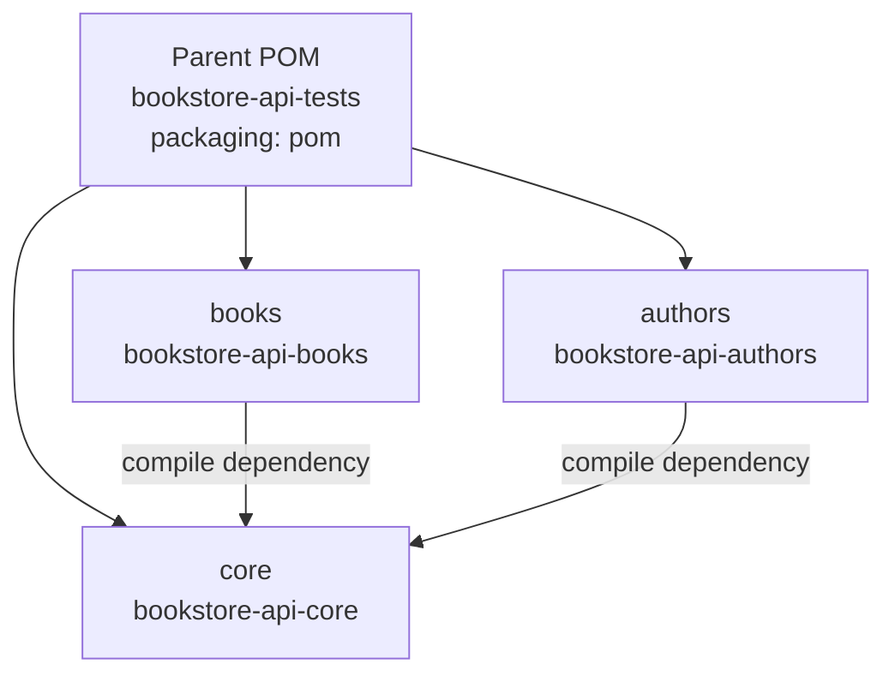
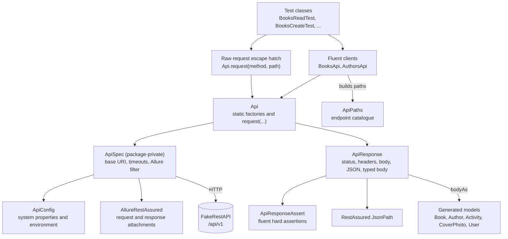

# Design overview

This document explains the structure of the `bookstore-api-tests` repository: what it tests, how the modules and classes fit together, how a test is written, and how the build is configured. It describes the code in this repository. It does not restate every test case; the design decisions live in `docs/adr/`.

The service under test is the public FakeRestAPI bookstore at `https://fakerestapi.azurewebsites.net`, with the path prefix `/api/v1` (`core/src/main/java/io/github/tasostilsi/bookstore/config/ApiPaths.java`).

## 1. What the suite tests and why

The suite exercises the Books and Authors resources of a public demo API. Neither resource requires authentication. The API is stateless: a successful write returns an echo of the request and persists nothing. Several responses also contradict common REST expectations. For example, `POST /Books` returns `200` rather than `201`, `DELETE /Books/1` returns `200` with an empty body rather than `204`, and `PUT /Books/1` takes the resource id from the body rather than the path.

The tests assert what the service actually does. They do not assert textbook REST behaviour that the service does not implement. This is the central rule of the suite, and it is recorded in the ADRs on evidence and on the test taxonomy.

The suite covers:

- Books read, create, update and delete, including validation and path binding (`books/src/test/java/io/github/tasostilsi/bookstore/books/`).
- The HTTP layer itself: empty response bodies and absent `Content-Type` headers (`core/src/test/java/io/github/tasostilsi/bookstore/http/ApiResponseEdgeTest.java`).
- The generated models, using a measured wire payload (`core/src/test/java/io/github/tasostilsi/bookstore/model/ModelDeserialisationTest.java`).

- Authors read, write and by-book, including the collection's regenerated-data invariants (`authors/src/test/java/io/github/tasostilsi/bookstore/authors/`).

The remaining planned work is infrastructure rather than coverage: the CI workflow, the README and the public repository. Every test class in the plan exists. See section 9 for the current state.

### Current inventory

| Area | Committed today | Plan target |
|---|---|---|
| `core` tests | 9 cases in 3 classes (`ApiResponseEdgeTest`, `ModelDeserialisationTest`, `BooksAuthorsConsistencyTest`) | Complete |
| `books` tests | 54 cases across 7 classes | Complete |
| `authors` tests | 23 cases in 3 classes (`AuthorsReadTest`, `AuthorsWriteTest`, `AuthorsByBookTest`) | Complete |
| Reactor total | 73 methods, 86 cases | 73 methods, 86 cases |

The plan targeted 74 methods and 87 cases. The difference is one method: `ErrorFormatTest` shipped three cases rather than four, because its fourth asserted the same request and the same two absences as `BooksDeleteTest.deleteExistingReturns200WithEmptyBody` and added nothing.

## 2. The four-module reactor

The repository is a Maven reactor with a parent POM and three modules:



The parent declares the modules and owns every version (`pom.xml`). Module POMs declare dependencies without versions (`core/pom.xml`, `books/pom.xml`, `authors/pom.xml`).

What belongs in each module:

| Module | Contents |
|---|---|
| `core` | Shared code: configuration, HTTP wrapper, fluent clients, generated models, and the infrastructure test classes, including the cross-service test that needs both clients. |
| `books` | Books test classes and their JSON fixtures, including the protocol and error-format classes. |
| `authors` | Authors test classes and their JSON fixtures. |

The dependency arrow points one way. `books` and `authors` depend on `core`; `core` has no dependency on either service module. That is what keeps the reactor acyclic and lets a cross-service test live in `core`, where both clients are already visible. The rule is visible in `core/pom.xml`, which declares no internal dependency.

Why modules at all: adding a service means adding a module, a client class, a block in `ApiPaths` and a test package. It does not mean editing a shared class list. The cost is three extra POMs. For a single-service suite that cost would not be worth paying. Here the module boundary is part of the structure a reader is meant to see.

The ADR on the four-module reactor records the alternatives: a single module, and a fifth module for cross-service tests.

## 3. Client and assertion layering

Every request goes through `io.github.tasostilsi.bookstore.client.Api`. No test calls RestAssured `given()` directly. This is checked by reading the test sources: `books/src/test`, `authors/src/test` and `core/src/test` contain no `given()` call.



The request path:

1. A test calls a terminal on a fluent client, for example `Api.books().get(1)` (`core/src/main/java/io/github/tasostilsi/bookstore/client/BooksApi.java`).
2. The terminal calls `Api.request(...)` (`core/src/main/java/io/github/tasostilsi/bookstore/client/Api.java`).
3. `Api.request` obtains a `RequestSpecification` from `ApiSpec.request()`, adds headers, content type and body when supplied, executes the request, and wraps the RestAssured `Response` in `ApiResponse`.
4. `ApiSpec` sets the base URI, connect and read timeouts, the `AllureRestAssured` filter, and optional request/response logging. It sets no default `Content-Type`; the body-bearing client calls set that header explicitly (`core/src/main/java/io/github/tasostilsi/bookstore/client/ApiSpec.java`).

The response path:

1. `ApiResponse` exposes `status()`, `header(name)`, `contentType()`, `body()`, `hasBody()`, `json()`, `bodyAs(Class)`, `bodyAsList(Class)` and `assertThat()` (`core/src/main/java/io/github/tasostilsi/bookstore/http/ApiResponse.java`).
2. `contentType()` reads the raw `Content-Type` header rather than `getContentType()`, because the latter normalises an absent header to an empty string. The contract distinguishes absent from empty.
3. `json()`, `bodyAs()` and `bodyAsList()` call `requireBody()` first. If the body is empty they throw `IllegalStateException` naming the status and status line, rather than letting a parser fail with an opaque message.
4. `assertThat()` returns an `ApiResponseAssert`, a fluent chain of hard assertions (`core/src/main/java/io/github/tasostilsi/bookstore/http/ApiResponseAssert.java`).
5. The generated models are the response-side type target. `bodyAs` and `bodyAsList` deserialise into them.

`ApiPaths` is the single endpoint catalogue (`core/src/main/java/io/github/tasostilsi/bookstore/config/ApiPaths.java`). It holds `BASE_PATH`, `BOOKS`, `AUTHORS`, `AUTHORS_BY_BOOK`, and the overloads `book(int)`, `book(String)`, `author(int)`, `author(String)`, `authorsByBook(int)` and `authorsByBook(String)`. The string overloads concatenate the segment verbatim, so a test can express a non-integer path segment such as `abc` or `1.5`.

`ApiConfig` is the configuration boundary (`core/src/main/java/io/github/tasostilsi/bookstore/config/ApiConfig.java`). `baseUri()` reads the `api.baseUri` system property, then the `API_BASE_URI` environment variable, then the default. The timeout and logging settings read only system properties.

The `Api.request` overloads are the escape hatch for requests that do not fit a resource terminal: unsupported methods, path-binding probes and custom headers. `request(String, String)` sends a bare request, `request(String, String, Map)` adds headers, and `request(String, String, String, String, Map)` adds a body and its `Content-Type`. A raw request carries no client `@Step`, so its Allure entry contains only the `HTTP exchange` step from `AllureRestAssured`. That is why the protocol tests planned for Task 12 use `Api.request` and accept the shorter report entry.

The ADRs on the fluent client and on the response wrapper record why there is no generic request builder and no raw RestAssured assertions in tests.

## 4. How a test is written

Test classes carry class-level Allure labels and a TestNG group on each method. This is the pattern from `books/src/test/java/io/github/tasostilsi/bookstore/books/BooksReadTest.java`:

```java
@Epic("Bookstore API")
@Feature("Books read")
@Severity(SeverityLevel.CRITICAL)
@Link(name = "OpenAPI specification", url = "https://fakerestapi.azurewebsites.net/swagger/v1/swagger.json")
public class BooksReadTest {
```

A representative method from the same file:

```java
@Test(groups = "contract")
public void getExistingBookReturnsIt() {
    ApiResponse r = Api.books().get(1);
    r.assertThat().hasStatus(200)
            .hasField("id", 1).hasField("title", BOOK_1_TITLE)
            .hasField("pageCount", BOOK_1_PAGE_COUNT).hasNonNullField("description");
    assertThat(r.json().getMap("$").keySet(), containsInAnyOrder(
            "id", "title", "description", "pageCount", "excerpt", "publishDate"));
}
```

What each part does:

- `@Test(groups = "contract")` makes the method selectable with `-Dgroups=contract`. Groups are declared on every method, not inherited from the class, so a renamed class cannot silently fall out of a group-based run.
- `Api.books().get(1)` is the only HTTP call. The test does not build a request specification and does not know the base URI or path prefix.
- `assertThat()` starts the assertion chain. Each call returns the same assertion object, so the chain reads as one statement.
- `hasField` reads through JsonPath. `hasNonNullField` checks presence and non-null in one call.
- The final Hamcrest assertion checks the exact top-level key set. It is written directly because the chain does not express set equality. Hamcrest arrives transitively with RestAssured; no AssertJ dependency is declared.
- `BOOK_1_TITLE` and `BOOK_1_PAGE_COUNT` come from `books/src/test/java/io/github/tasostilsi/bookstore/books/data/BooksData.java`. Fixtures are constants, not a shared base class.

Deviation and validation-gap methods add method-level labels. `BooksCreateTest.createWithEmptyObjectReturnsDefaults` shows both:

```java
@Test(groups = {"deviation", "validationGap"})
@Feature("Contract deviations")
@Feature("Validation gaps")
public void createWithEmptyObjectReturnsDefaults() {
    Api.books().create(EMPTY_OBJECT).assertThat().hasStatus(200).isVersionedJson()
            .hasField("id", 0).hasNullField("title").hasField("pageCount", 0)
            .hasNullField("description").hasNullField("excerpt")
            .hasField("publishDate", ZERO_DATE_DEFAULT);
}
```

`@Feature` is repeatable. A method in two groups carries two overrides, which is what moves it into both sections of the Allure Behaviors view. A deviation whose method name does not already state the deviation also carries `@Description`, for example `BooksDeleteTest.deleteExistingReturns200WithEmptyBody`.

Request bodies are raw JSON strings. The service accepts empty, malformed, partial, array and wrong-type bodies. A typed constructor would default fields and silently change the payload under test. Generated types are used only on the response side.

Data providers expand a method into several cases. `BooksReadTest` has a provider for the four absent ids and one for the publish-date samples. The case count is therefore higher than the method count.

## 5. Requests, assertions and Allure steps

Three mechanisms connect a test to the report.

**`@Step` on client terminals.** Each resource operation carries an Allure `@Step` naming the verb and path, for example `@Step("GET /Books/{id}")` and `@Step("POST /Books")`. The one-argument `create(String)` delegates to the annotated `create(String, String)` overload. The method parameters fill the `{id}` placeholder, which requires `<parameters>true</parameters>` on `maven-compiler-plugin` (`pom.xml`). A test such as `deleteDoesNotRemoveResource` therefore records two steps, `DELETE /Books/1` and `GET /Books/1`, without any `Allure.step` wrapper in the test.

**AspectJ weaving.** `@Step` writes nothing unless the AspectJ weaver is attached to the test JVM. The parent POM declares `aspectjweaver` as a Surefire plugin dependency and passes it as `-javaagent` on `argLine` (`pom.xml`). The path is quoted because Surefire tokenises `argLine` before forking. A missing agent produces no steps and no error, which is why the planned CI workflow checks for a named step rather than only a non-empty steps array.

**`AllureRestAssured`.** `ApiSpec` registers the filter on every request. It adds an `HTTP exchange` step containing the request and response attachments. This is why tests that go through `Api.request` still have a report entry even though `Api.request` itself has no `@Step`.

The result files go to each module's `target/allure-results`, because Surefire sets the `allure.results.directory` system property (`pom.xml`). The `allure-testng` listener is registered by the library's service file, so no `testng.xml` and no listener wiring appear in the project. `./mvnw -B allure:aggregate` combines the module results into `target/site/allure-maven-plugin`.

Assertions do not create Allure steps. They are hard assertions executed inside the test method. A failure throws from the assertion chain, and the stack includes the test line that called it, so the failing test is identifiable.

## 6. Spec snapshot and generated models

The service publishes an OpenAPI 3.0.1 document at `/swagger/v1/swagger.json`. A snapshot is committed at `core/src/main/resources/spec/openapi.json`. It contains 12 paths, 27 operations and five schemas (`Activity`, `Author`, `Book`, `CoverPhoto`, `User`).

Models are generated from the committed snapshot, never from the URL. A build therefore does not need the demo service to be reachable, and two builds on different days cannot disagree about the contract.

The generator is configured in `core/pom.xml`:

| Setting | Value | Effect |
|---|---|---|
| `openapi-generator-maven-plugin` | 7.26.0 | Version from the parent property. |
| goal | `generate` at `generate-sources` | Runs before compilation. |
| `inputSpec` | `${project.basedir}/src/main/resources/spec/openapi.json` | The committed snapshot. |
| `generatorName`, `library` | `java`, `native` | Java models with the native HTTP library support code. |
| `modelPackage` | `io.github.tasostilsi.bookstore.model` | Where the five model classes land. |
| `invokerPackage` | `io.github.tasostilsi.bookstore.generated` | Keeps `ApiClient`, `JSON` and the generated `ApiResponse` out of the project root package, away from the hand-written `http.ApiResponse` and `client.Api`. |
| `generateApis` | `false` | No API stubs. |
| `generateSupportingFiles` | `true` | Required: generated models call `ApiClient.urlEncode`, so the support classes must exist. |
| `generateModelTests`, `generateModelDocumentation` | `false` | Models only. |
| `openApiNullable` | `false` | Plain types, not `JsonNullable` wrappers. |
| `dateLibrary` | `java8` | `publishDate` becomes `OffsetDateTime`. |
| `serializationLibrary` | `jackson` | Jackson annotations and `JSON` mapper. |
| `useJakartaEe` | `true` | `jakarta.annotation` imports. |
| `hideGenerationTimestamp` | `true` | Reproducible generated sources. |

The output is `core/target/generated-sources/openapi`. The generated code is build output, not committed. The generated `core/target/generated-sources/openapi/src/main/java/io/github/tasostilsi/bookstore/model/Book.java` declares `publishDate` as `OffsetDateTime`.

To refresh the snapshot:

```bash
scripts/refresh-openapi-spec.sh
```

The script downloads the live document with `curl -fsSL`, validates that it is JSON with `openapi`, 12 paths and 5 schemas using `jq -e`, replaces `core/src/main/resources/spec/openapi.json`, sets the file mode, runs `./mvnw -B -pl core generate-sources`, and prints `git diff --stat` for the snapshot (`scripts/refresh-openapi-spec.sh`). The `-f` flag matters: without it an HTML error page would overwrite the tracked file. The `jq` guard rejects a truncated body or a maintenance page before the tracked file is replaced.

The models are a response-side oracle. Request payloads stay as JSON strings in the test fixtures. `ApiResponse.bodyAs` and `bodyAsList` deserialise into the generated types, and a field the spec does not declare makes the generated Jackson mapper ignore it unless a test enables strict handling. `ModelDeserialisationTest` copies the generated mapper and enables `FAIL_ON_UNKNOWN_PROPERTIES`, then deserialises a measured `GET /Books` payload and asserts that `publishDate` binds as `OffsetDateTime` (`core/src/test/java/io/github/tasostilsi/bookstore/model/ModelDeserialisationTest.java`).

One response does not fit the generated type. A `PUT /Books/1` with `{}` or a partial body returns `"publishDate":"0001-01-01T00:00:00"`, which has no UTC offset and cannot parse as `OffsetDateTime`. The update test asserts that value through JsonPath with `hasField`, not through `bodyAs` (`books/src/test/java/io/github/tasostilsi/bookstore/books/BooksUpdateTest.java`). This is a recorded deviation, not a workaround: the assertion states what the service returns.

The ADR on generated models records why the snapshot is committed and what was rejected.

## 7. Test taxonomy

Every method carries at least one selection group. The three primary groups classify the behaviour. Two further groups mark orthogonal properties and can be combined with any primary group.

| Group | Meaning | Allure label |
|---|---|---|
| `contract` | Observed behaviour that also matches a reasonable REST expectation. | Class `@Feature` (no override). |
| `deviation` | Observed behaviour that contradicts a REST or RFC convention. | `@Feature("Contract deviations")` |
| `validationGap` | Input that should be rejected but is accepted, or the reverse. | `@Feature("Validation gaps")` |
| `dynamicData` | The assertion depends on a value regenerated per request. Orthogonal to the primary groups. | `@Feature("Dynamic data")` |
| `crossservice` | The assertion spans Books and Authors. Orthogonal to the primary groups. | `@Feature("Cross-service consistency")` |

The rule that decides the primary group:

1. Compare the observed response with the convention that applies to the operation: the HTTP method semantics in RFC 9110, the problem-details shape, or the OpenAPI document's declared types.
2. If the response agrees with the convention, use `contract`.
3. If the response contradicts the convention, use `deviation`.
4. If the contradiction is specifically about validation, meaning the service accepted input a contract should reject or rejected input it should accept, also add `validationGap`. A method can therefore carry `{"deviation", "validationGap"}`.
5. Independently of the above, add `dynamicData` when the assertion reads a value the service regenerates per request, and `crossservice` when the test calls both Books and Authors.

Examples from the committed code:

- `createEchoesPayloadWith200AndNoLocation` is `deviation`: `POST` returns `200` and no `Location`, where RFC 9110 expects `201` with a `Location` for a created resource.
- `createAcceptsNegativePageCount` is `validationGap`: a negative page count is accepted with `200`.
- `createWithEmptyObjectReturnsDefaults` is both `deviation` and `validationGap`: an empty object is accepted and reset to defaults.
- `publishDateIsNowMinusNDays` is `dynamicData`: it compares the response `publishDate` with the response `Date` header.
- The planned `BooksAuthorsConsistencyTest` methods will be `crossservice`, and `statelessnessSpansBothResources` will also be `deviation`.

Class-level labels are separate from the selection groups. Every class carries `@Epic("Bookstore API")`, a class-level `@Feature` naming the area and a class-level `@Severity`. `@Link` points at the Swagger document on the service-area classes (`BooksReadTest`, `BooksCreateTest`, `BooksUpdateTest`, `BooksDeleteTest`, `BooksValidationTest`). The `core` infrastructure classes carry no link, because they assert the client and the generated types rather than a documented endpoint.

Severity is per class, not per method. `CRITICAL` is used on the primary CRUD classes, `NORMAL` on `BooksValidationTest`, and `MINOR` on the two `core` infrastructure classes. A deviation method inside a CRUD class therefore reports at that class's severity. The README is planned to say so; it does not promise per-method severity.

There is no `@Story` label and no `testng.xml`. The method-level `@Feature` override already separates deviations and validation gaps in the Behaviors view, and a second hierarchy would duplicate it. Selection by class, package or group is enough; a suite XML would let a renamed class drop out of a run silently.

At the time of writing, the group filters select these case counts across the reactor:

| Group | Cases |
|---|---|
| `contract` | 50 |
| `deviation` | 20 |
| `validationGap` | 7 |
| `dynamicData` | 5 |
| `crossservice` | 6 |

The rows do not sum to the 86 cases in the suite, for two reasons. Five methods carry two groups: four `{"deviation", "validationGap"}` cases between `BooksCreateTest` and `AuthorsWriteTest`, and one `{"crossservice", "deviation"}` case in `BooksAuthorsConsistencyTest`. Three `core` cases carry no group at all: the generated-model and response-wrapper infrastructure tests. Five double-counted cases less three ungrouped ones is the difference of two between the 88 the rows add up to and the 86 cases in the suite. The ADR on the test taxonomy records the alternatives and the label mapping.

## 8. Evidence discipline

Every expected value in the suite comes from a measurement of the live service, not from the OpenAPI document. The document declares only `200` responses, even for `POST` and `DELETE`, and no schema declares `required` fields. It cannot decide status codes, required fields or error shapes. The measured behaviour is recorded in the test that asserts it, and the reasoning in the ADRs.

The rules that follow from that:

- An assertion encodes measured behaviour. If a test fails, the first response is to re-probe the live service, not to change the assertion. The plan states that a previously green test that reds is re-probed once and reported before any assertion is edited.
- The service is never worked around. There is no fallback payload, no response normalisation, no retry, and no relaxed assertion. The service is not ours to fix.
- There are no retries. The Surefire POM contains no `rerunFailingTestsCount` or retry plugin (`pom.xml`). `dynamicData` is an exclusion group for CI, not a retry mechanism.
- Empty bodies are handled, not parsed. `ApiResponse` guards `json()`, `bodyAs()` and `bodyAsList()` with `requireBody()` and throws `IllegalStateException` naming the status. `ApiResponseEdgeTest` pins this against a locally built empty `200`, so the test states the wrapper's rule without depending on which endpoint returns one; `BooksDeleteTest` asserts the live `DELETE /Books/1` shape.
- Absent `Content-Type` is asserted from the header map only. `ApiResponseAssert.hasNoContentType()` reads `contentType()` and never parses the body. `ApiResponseEdgeTest.absentContentTypeDoesNotParseBody` pins this against a locally built `405` with no content type, and the planned `ProtocolTest` pins the live `405`.
- The zero date from an empty `PUT` is asserted through JsonPath, because the generated `OffsetDateTime` cannot represent a value without an offset.

Known limits, recorded rather than hidden:

| Limit | Reason |
|---|---|
| A request with no `Content-Type` header cannot be sent. | RestAssured wraps a `String` body in an Apache `StringEntity` whose content type is `text/plain; charset=ISO-8859-1`, and `RequestEntityProxy` re-adds it at execution time. A `byte[]` body emits `application/octet-stream`. The `415` contract is pinned with `text/plain` instead. |
| `HEAD /Books/1` is not tested. | The service blocks for about 25 seconds before returning `405`. A timeout test would encode the client, not the contract. |
| The Authors population is not asserted by total. | The service regenerates it per request; totals were measured between 586 and 629. |
| A network outage reads as a test failure. | The suite runs against the public host and has no retry. The planned CI health gate fails before the suite so a dead host is distinguishable from a contract failure. |
| There is no mock or stub. | The purpose is to test the live contract. |

The ADR on no retries records the alternatives and the absent-`Content-Type` limit in full.

## 9. Current state and what is planned

The work was planned in 17 tasks. The first fourteen are implemented in the committed tree; tasks 15 to 17 cover CI, the README and the public repository and are not built yet.

| Task | Scope | State |
|---|---|---|
| 1 | Reactor skeleton, wrapper, `ApiConfig`, `ApiPaths` | Built |
| 2 | Spec snapshot, generator, `ModelDeserialisationTest`, refresh script | Built |
| 3 | HTTP layer, fluent clients, `ApiResponseEdgeTest` | Built |
| 4 | Books read tests and `BooksData` | Built |
| 5 | Books create tests | Built |
| 6 | Books update tests | Built |
| 7 | Books delete tests | Built |
| 8 | Books validation and path tests | Built |
| 9 | Authors read tests, `AuthorsData` | Built |
| 10 | Authors write tests | Built |
| 11 | Authors by-book tests | Built |
| 12 | `books/.../protocol/ProtocolTest` | Built |
| 13 | `books/.../protocol/ErrorFormatTest` | Built |
| 14 | `core/.../crossservice/BooksAuthorsConsistencyTest` | Built |
| 15 | `.github/workflows/api-tests.yml` and Pages | Planned |
| 16 | `README.md` | Planned |
| 17 | Public repository and Pages settings | Planned |

The `authors` module has three test classes, `AuthorsReadTest`, `AuthorsWriteTest` and `AuthorsByBookTest`, and a `data/AuthorsData` fixture class. The `books` module has seven test classes and a `BooksData` fixture class under `books/src/test/java/io/github/tasostilsi/bookstore/books/data/`; two of the seven sit in a `protocol` subpackage. The `core` module has the configuration, HTTP, client and test classes listed in section 3, plus the generated models under `core/target/generated-sources/openapi`. There is no `README.md`, no `.github/` directory and no CI workflow in the repository.

## 10. Configuration and running

Configuration keys (`core/src/main/java/io/github/tasostilsi/bookstore/config/ApiConfig.java`, `pom.xml`):

| Key | Default | Override |
|---|---|---|
| Base URI | `https://fakerestapi.azurewebsites.net` | `-Dapi.baseUri=...` or `API_BASE_URI` |
| Connect timeout | 5000 ms | `-Dapi.connectTimeoutMs=...` |
| Socket timeout | 10000 ms | `-Dapi.socketTimeoutMs=...` |
| Console logging | `false` | `-Dapi.logAll=true` |
| Allure results directory | `${project.build.directory}/allure-results` | Set in `pom.xml` under Surefire `systemPropertyVariables`; change it there. |
| Allure report CLI | 3.17.0 | `allure.reportVersion` property in `pom.xml`. |

The build uses the committed Maven wrapper, which resolves Maven 3.9.16 (`.mvn/wrapper/maven-wrapper.properties`). The compiler targets Java 17 with `<parameters>true</parameters>` (`pom.xml`). The local run used JDK 25; the planned CI uses JDK 21.

Commands:

```bash
# Run the whole reactor and produce per-module Allure results.
./mvnw -B clean verify

# Combine the module results into one static report.
./mvnw -B allure:aggregate

# Read the report in a browser. This serves it; do not open index.html from disk.
./mvnw -B allure:serve

# Run one module with its dependencies.
./mvnw -B -pl books -am verify

# Run one group.
./mvnw -B -pl books -am verify -Dgroups=deviation

# Run one class.
./mvnw -B -pl core -Dtest=ModelDeserialisationTest test

# Regenerate the models from the committed snapshot.
./mvnw -B -pl core generate-sources
```

`clean` matters locally: `allure-results` accumulates across runs, so without it the report shows tests that no longer exist. `allure:serve` is the supported way to read the report because Allure loads its data over XHR from relative paths. Opening `target/site/allure-maven-plugin/index.html` from disk is not the documented path.

`scripts/refresh-openapi-spec.sh` is the only command that rewrites a tracked file. Run it deliberately, review the snapshot diff, and commit the new snapshot if the generated models still compile.
